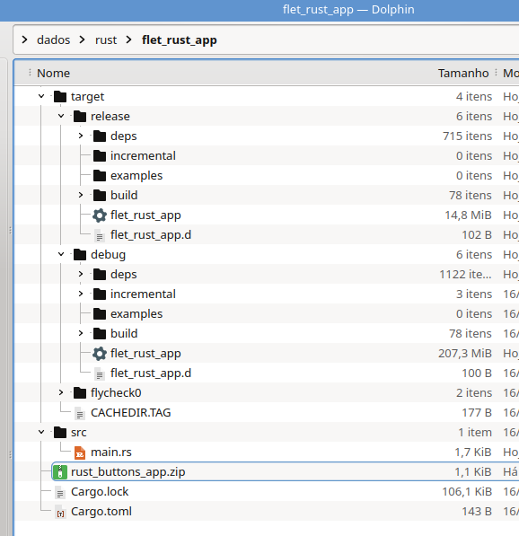

# Rust
Just some examples conversions

## Instalação rustup no Linux ou macOS

curl https://sh.rustup.rs -sSf | sh

O script de instalação adiciona Rust automaticamente ao PATH do sistema após seu próximo login. Se você deseja começar a usar Rust imediatamente, em vez de reiniciar o terminal, execute o seguinte comando no shell para adicionar Rust ao PATH do sistema manualmente:

$ source $HOME/.cargo/env

Como alternativa, você pode adicionar a seguinte linha ao seu ~/.bash_profile:

$ export PATH="$HOME/.cargo/bin:$PATH"

## Solução de Problemas

Para verificar se você possui Rust instalado corretamente, abra um shell e digite esta linha:

$ rustc --version

## Ficheiros e Pastas do Rust

  

### Cargo.toml
Este ficheiro tem a configuração dos ficheiros e dependências necessárias

name = "flet_rust_app"
version = "0.1.0"
edition = "2021"

dependências
eframe = "0.28" # Framework para janelas e aplicações GUI

### main.rs
O ficheiro main.rs, é onde se  faz a programação e fica na pasta scr

## Correr e compilar o programa
cargo run
<i> (O executável é gerado em target/debug/).</i> - Usar para programar

cargo run --release
<i>(O executável é gerado em target/release/).</i> - Usar para enviar a alguém
